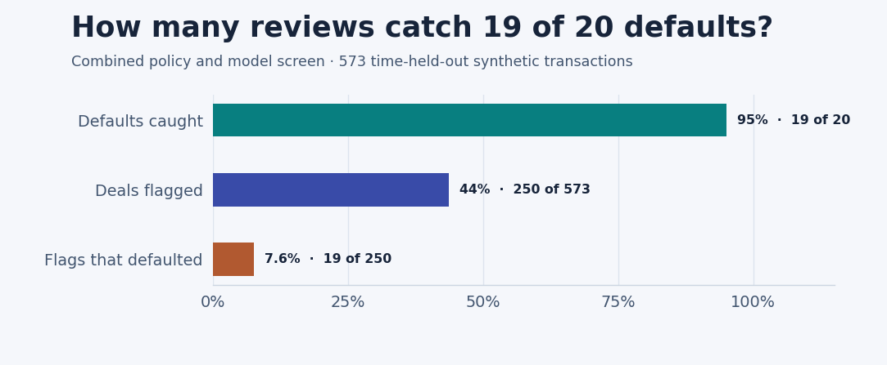

# AI Credit Intelligence

An invoice-discounting case study for small-business lending. The pipeline applies explicit credit-policy rules, benchmarks invoice exposure against peers, and scores default risk with XGBoost. It also surfaces portfolio drift and anomalies and extracts selected financial values from sample English and Arabic reports.



## What the evaluation found

On the saved time-held-out validation set, the combined policy and model screen flagged **250 of 573 transactions** and caught **19 of 20 defaults**. The screen sent 231 non-defaulting transactions to review and missed one default. On the 431 transactions that passed the policy gate, the XGBoost stage achieved **0.652 average precision** with a **3.25%** default rate.

The low precision quantifies the cost of choosing a recall-first threshold. The transactions are synthetic, so these figures describe the case-study evaluation.

[Combined validation metrics](reports/layer1_validation_metrics.csv) · [Stage C metrics](reports/stage_c_metrics.csv) · [Precision–recall plot](reports/stage_c_precision_recall.png) · [SHAP summary](reports/stage_c_shap_feature_importance.png)

## How a transaction moves through the pipeline

| Step | Implementation | What a reviewer gets |
| --- | --- | --- |
| Policy gates | [Hard-filter rules](config/hard_filters.json) | Explicit rule hits for documents, country risk, ratings, and disputes |
| Peer benchmarks | [Feature transformer](src/rawasi_credit/benchmarks.py) | Exposure ratios and median/MAD outlier scores, with fallback for sparse peer groups |
| Default scoring | [XGBoost training script](scripts/run_stage_c_model.py) | Default probabilities, threshold analysis, and per-deal SHAP reasons |
| Portfolio monitoring | [Intelligence notebook](notebooks/02_layer2_intelligence.ipynb) | Default-rate clusters, population stability index (PSI), and anomaly alerts |
| Document extraction | [OCR report](reports/document_intelligence/document_intelligence_report.md) | Label-anchored extraction of revenue, net income, and total assets from two sample reports |

A fresh OCR run matched all six target values across the two sample reports. The [model-evolution notebook](notebooks/03_layer3_blind_spot_analysis.ipynb) examines blind spots and outlines retraining triggers. The optional portfolio narrative uses OpenRouter when a key is configured.

## Run locally

Use Python 3.11 or later and run from the repository root. Write generated files to `outputs/` so the checked-in evaluation remains available for comparison.

```bash
python -m venv .venv
source .venv/bin/activate
python -m pip install -r requirements.txt
python scripts/run_stage_a_filters.py --output-dir outputs
python scripts/run_stage_b_benchmarks.py --output-dir outputs
python scripts/run_stage_c_model.py --output-dir outputs --model-dir outputs/models
```

The three scoring scripts use the [included synthetic invoice dataset](utils/rawassi_synthetic_dataset.csv) by default. The optional document track uses ImageMagick with PDF-rendering support and Tesseract with English and Arabic language data.

```bash
python scripts/run_document_intelligence.py --output-dir outputs/ocr
```

Start with the [exploratory notebook](notebooks/01_data_understanding_eda.ipynb) or the [data audit](docs/data_audit.md) for the data and validation split. This case study is available under the [MIT License](LICENSE).
